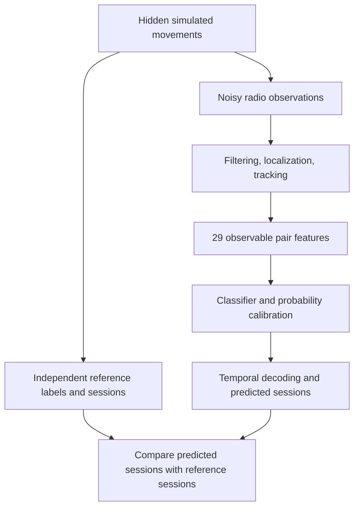

# Understanding MDR-SIM: a beginner's guide from the problem to the paper

**Based on the project's saved implementation, manuscript, and research-v7-2026-10-06 evidence release. Written on 6 October 2026.**

You do not need to know wireless engineering, machine learning, or advanced mathematics to begin this guide. Read it in order the first time. Each idea builds on an earlier one. Formulas are explained in words and through examples; you can understand the system before becoming comfortable with every symbol.

This is a learning companion to the research paper, not a new experiment or a replacement for its evidence. Numbers below describe the retained simulation. Examples explicitly called *illustrative* are teaching examples, not additional measured results.

## Contents and a suggested learning route

1. The problem and what the project actually does
2. The basic vocabulary
3. The physical world, observations, estimates, and decisions
4. The contact definition and its mathematics
5. Why the original approach struggled
6. The simulated environment and movement
7. RSSI, angles, phase, timing, and UWB
8. The seven configurations and their fairness assumptions
9. Filtering, localization, tracking, and missing information
10. The complete 29-feature input
11. What the machine learning learns
12. Four classifier families, calibration, and model selection
13. Turning frame probabilities into contact sessions
14. Markov modeling and ablations
15. Data partitions and leakage prevention
16. Evaluation formulas and worked examples
17. The actual results and their interpretation
18. Hospital cost, capacity, and deployment
19. The project's history and file structure
20. Running, reproducing, and checking the work
21. Reading and explaining the paper
22. What is established, what remains open, and what to learn next
23. Glossary and self-check questions

For a first reading, focus on Sections 1–6, 8–11, 13, 15–17, and 21–22. Return to the wireless and mathematical details afterward. For a second reading, trace one imaginary pair through the entire pipeline and explain each stage aloud.

## 1. The problem: reconstructing who spent time near whom

Imagine a hospital with patients, nurses, doctors, and other staff wearing small electronic tags. Fixed receivers are installed around the building. A useful system might produce a record such as:

> Tag A and Tag B were close to each other in the same room from approximately 10:05:00 to 10:06:10.

That record is a **contact session**. The project asks how to reconstruct such sessions from imperfect wireless measurements.

A receiver does not normally observe the exact distance between every pair of people. It observes radio signals from individual tags. Software must use those signals to estimate positions or other evidence, decide whether two tags appear close, and decide whether that proximity lasts long enough to count as a sustained contact.

The central research question is:

> Under a declared simulation, can learned decisions using signal information and recent history reconstruct sustained contacts better than tuned geometric rules, and how does the answer change when angular or ranging information is available?

Hospital affordability motivates the project. However, the study does not measure hospital hardware prices, patient outcomes, infection transmission, or battery life. Its output is reconstructed geometric proximity, not infection risk.

Your current study is a **simulation study**. A program creates movements, radio observations, and known reference contacts. It trains and evaluates algorithms on those synthetic observations. This makes controlled comparisons possible, but the conclusions depend on the assumptions used to generate the world and the radio errors.

## 2. The basic vocabulary

| Term | Plain-language meaning in this project |
|---|---|
| Tag / wearable | A moving device representing one person. |
| Gateway / anchor / receiver | A fixed device with a known location that observes tags. The exact capabilities vary by configuration. |
| BLE | Bluetooth Low Energy, a wireless technology used as the project's basic telemetry context. |
| Telemetry | Measurements and messages received from devices. |
| Observation | A measured or simulated radio value, such as signal strength, bearing, phase, or a timing interval. |
| Ranging | Estimating distance between a tag and an anchor. |
| Localization | Estimating a tag's position on the map from observations. |
| Tracking | Updating estimated position and movement over time. |
| Pair | Two tags considered together. A–B and B–A are the same unordered pair in v7. |
| Frame | One sampled instant. The main study uses one frame per second. |
| Pair-frame | One pair evaluated at one sampled instant. |
| Session / event | A continuous qualified interval of proximity. |
| Ground truth / reference | The answer generated from hidden true positions and the declared contact definition. |
| Feature | A numerical input to a learning algorithm. |
| Label / target | The answer the learning algorithm is trained to predict. |
| Prediction | An algorithm's output for an observation. |
| Modality / observation budget | Which kinds of radio information an algorithm is allowed to use. |
| Seed | A number that initializes reproducible pseudo-random choices. |
| Recording | One simulated movement sequence, with associated observations and labels. |
| Baseline / control | A comparison method, usually simpler than the proposed method. |
| Held out | Kept separate from fitting or selection so it can evaluate previously chosen methods. |
| Protocol | The written, fixed rules for an experiment. |

For example, “the held-out seed-grouped event-F1 evaluation” means: test on whole recordings that were not used to choose the method, and score the reconstructed contact sessions using F1.

## 3. Four layers that you must keep separate

The whole project becomes easier to understand when you distinguish four layers.

1. **Physical truth:** where every simulated tag really is.
2. **Radio observations:** what a receiver appears to measure after noise, loss, and bias.
3. **Estimated evidence:** positions, distances, signal comparisons, and recent histories computed from observations.
4. **Contact decisions:** predicted proximity and sustained sessions.



The hidden positions generate observations and the reference answer. They are not given to the inference system at prediction time. Otherwise, the software could simply read the answer instead of solving the problem.

**Illustrative example:** true separation is 1.7 m. Noisy localization suggests 2.4 m. The radio profiles and recent history still suggest proximity. A learned model might assign probability 0.65. A temporal decoder then determines whether the pair produces a qualified session. These are different values at different stages; none should be substituted for another.

The public floor plan and anchor locations are available to inference. That is a stated source of information. True tag coordinates, true rooms, true pair distances, and reference-contact status are excluded from its feature interface. Device identities associate measurements over time, but are not predictor columns.

## 4. Exactly what counts as a contact

### 4.1 Coordinates and distance

A two-dimensional position is written as `(x, y)`, where x and y are distances in metres along two map axes. For two positions `(x1, y1)` and `(x2, y2)`, straight-line distance is:

`distance = sqrt((x1 - x2)^2 + (y1 - y2)^2)`

The symbol `sqrt` means square root. Squaring makes each difference nonnegative. Adding the squared differences combines movement along both directions. Taking the square root returns metres.

**Illustrative example:** A is at `(3, 4)` and B is at `(4.2, 5.6)`. The differences are 1.2 and 1.6 m. Distance is `sqrt(1.44 + 2.56) = sqrt(4) = 2 m`.

In the paper, `z_i(t)` means the true position of tag i at time t. `||z_i(t) - z_j(t)||_2` is the same straight-line distance. The vertical bars and subscript 2 indicate the Euclidean norm; they are a compact way to write the square-root calculation.

### 4.2 The instantaneous label

At each integer second, the reference label is 1 if both conditions hold:

- True separation is at most 2 m.
- Both tags are in the same room.

Otherwise it is 0. This is Equation (1) in the paper:

`y_ij(t) = indicator(distance <= 2 m) × indicator(same room)`

An **indicator** is a switch: 1 when its statement is true and 0 otherwise. Multiplication implements “both must be true.” Thus two tags 1 m apart on opposite sides of the wall receive label 0.

This is an operational research definition. It does not say that everyone within 2 m becomes infected, or that people farther apart cannot share airborne exposure.

### 4.3 Instantaneous proximity versus sustained contact

An instantaneous positive label describes one sample. A sustained session is a maximal consecutive run of positive labels spanning at least 30 elapsed seconds.

“Maximal” means extend the run until the positive sequence stops; do not split one uninterrupted run into arbitrary smaller sessions.

The exact rule is `end - start >= 30`. Positive samples at times 0 through 30 span 30 seconds and qualify. Samples at 0 through 29 span 29 seconds and do not qualify, even though there are 30 samples. With one-second sampling, qualification therefore requires at least 31 consecutive positive samples.

A 10-second close encounter supplies positive training labels during that encounter, but does not become a qualified reference session. The classifier learns **instantaneous proximity**; the complete system is judged primarily on **sustained sessions**.

The simulation checks integer-second samples. It does not prove that the tags were close at every instant between samples. Also, pair-time accounting uses inclusive positive samples, while session interval duration uses end minus start. Understanding this convention prevents off-by-one confusion.

## 5. Why the original gateway idea was not enough

The initial idea used gateway co-observation: if the same gateway sees two tags, perhaps those tags are near each other. A gateway can see a broad area, so this evidence alone is weak.

**Illustrative example:** a receiver in the middle of a room sees one person 7 m to its left and another 7 m to its right. Both are visible to the gateway, yet the people are 14 m apart. Even equal tag-to-gateway distances do not imply that two tags are close.

The corrected original v3 campaign used 50 people, eight gateways, 3,600 seconds, and 30 seeds. Under its own protocol, it produced:

- 84 reference sessions;
- 161 predicted sessions;
- 3 matched sessions;
- 158 false sessions;
- 81 missed sessions.

Its pooled precision was `3/161 = 1.86%`, and pooled recall was `3/84 = 3.57%`. These poor outcomes are retained as research evidence.

Another limitation was learning only from records that the initial reconstruction had already produced. If a true contact never became a candidate, a downstream scorer could not recover it. The original directed-record task had 322 records but only six positive directions, representing three distinct matched sessions. That is very sparse positive support.

The new main study evaluates **all pairs before session detection**. It learns observable proximity evidence throughout a recording and then constructs sessions. This addresses candidate-selection limitations, although it does not eliminate sensor errors or guarantee good contacts.

Do not subtract v3 results from v7 results to claim a controlled improvement. Their participants, maps, durations, scenarios, and protocols differ. The clean comparisons are between methods evaluated on the same v7 recordings.

## 6. The main simulated world

The v7 floor is 24 m wide and 20 m tall. A wall divides it at x = 12 m. A doorway runs from y = 9 to 11 m. Four anchors sit at `(2,2)`, `(22,2)`, `(22,18)`, and `(2,18)` m.

Eight tags move through 360 one-second frames, from t = 0 to 359. The exposure convention for pair-hours treats this as a 360-second recording; the largest possible sampled endpoint span is 359 seconds.

The number of unordered pairs among n tags is:

`pairs = n(n - 1)/2`

For eight tags, this gives `8 × 7 / 2 = 28`. Divide by two because A–B and B–A otherwise get counted twice. Each recording therefore has `360 × 28 = 10,080` unique physical pair-frames.

### Movement families

- **Ward encounters:** randomized pairs, locations, starts, durations, and separations, including long and brief encounters.
- **Doorway rounds:** continuous routes through the doorway with varying follower separation.
- **Threshold encounters:** phases close to the 2 m boundary, where small estimation errors can change the decision.
- **Unseen independent waypoints:** independently moving tags with pauses and speeds of 0.35–0.75 m/s, used only in the motion challenge.

Some scenarios deliberately place a close pair across the wall to test the same-room requirement. Tag assignments are shuffled to prevent a tag identifier from consistently meaning “the person who has contacts.” Movement checks verify doorway crossings and a maximum sampled step of 1.2 m.

These are designed research scenarios. They are not measured nurse schedules, patient movement records, or a digital replica of an actual hospital.

## 7. Understanding the wireless measurements

### 7.1 RSSI: received signal strength

RSSI means **Received Signal Strength Indicator**. It tells you how strong a received radio signal appears. In the simulation it is expressed in dBm, a logarithmic power unit referenced to one milliwatt. Among negative dBm values, −50 is stronger than −80.

In an idealized propagation model, signals weaken with distance. However, strength also changes with obstacles, device bias, noise, and other conditions. Therefore, weak signal is evidence about distance, not an exact ruler.

Equation (2) is:

`RSSI = -50 - 25 log10(max(0.1, distance)) + 6u + device_bias - wall_loss`

Read it one piece at a time:

- `-50`: reference strength at 1 m before errors.
- `log10`: base-10 logarithm. It turns multiplicative distance changes into additive strength changes.
- `-25 log10(distance)`: distance-related weakening, using path-loss exponent 2.5.
- `max(0.1, distance)`: never put a distance below 0.1 m into the logarithm.
- `6u`: a changing noise contribution, with nominal 6 dB scale.
- `device_bias`: an offset that persists for a device within a recording.
- `wall_loss`: an additional penalty on modeled blocked links.

**Illustrative noiseless calculation:** at 1 m, `log10(1) = 0`, so RSSI is −50 dBm. At 2 m, `log10(2) ≈ 0.301`, so it is about −57.5 dBm. At 10 m, `log10(10) = 1`, so it is −75 dBm. These are model calculations, not guaranteed real-device readings.

**Noise** varies over time. **Bias** systematically shifts observations. Averaging can reduce some noise while leaving a persistent bias.

The wall condition uses device-bias standard deviation 2 dB, wall attenuation 6 dB, and correlation parameter 0.8. Correlation means errors persist instead of completely changing each second. The changing noise state follows:

`u(t) = rho × u(t-1) + sqrt(1-rho^2) × epsilon(t)`

Here rho controls persistence, and epsilon is a fresh standard-normal random value. Standard deviation measures typical spread around a mean; a zero-mean Gaussian describes a bell-shaped error distribution, not a hard error bound.

The simulation also drops 10% of packets independently, drops observations below −95 dBm, and introduces three-second loss bursts in the wall condition. Lost observations must be handled by the inference system.

### 7.2 AoA: angle of arrival

An angle gives a **direction**, rather than a distance. If a receiver knows that a tag is along one direction from it, that restricts the tag to a ray. Another receiver's direction can help locate where the rays meet.

A bearing of 0° points along the chosen reference axis; 90° is a quarter turn. Radians are another angular unit: π radians = 180°. The code uses radians. Convert degrees to radians with `degrees × pi/180`.

Angles wrap around. Directions 179° and −179° differ by 2°, not 358°. Circular arithmetic handles this. An ordinary average can fail: averaging these two angles numerically gives 0°, the wrong direction. A circular mean averages their sine and cosine components, then recovers the direction.

The simulated bearings have 5° stochastic error. The wall condition adds persistent orientation bias with 2° standard deviation and a modeled 8° wall angular bias.

AoA2 upgrades two diagonal anchors; AoA4 upgrades all four. More direction observations can improve geometry and redundancy, but noise, bias, reception, and anchor placement still matter.

The project supplies synthetic bearings. It does not generate antenna-array IQ measurements or run a real Bluetooth direction-finding controller. IQ describes radio signal components often used in phase/direction processing; those lower-level samples are outside this simulation.

### 7.3 PBR: phase-based ranging

A radio wave repeats like a cycle. **Phase** describes where in that cycle the wave is. Propagation changes phase. At one frequency, repeated cycles cause ambiguity: the same observed phase can correspond to different travel distances. Looking at how phase changes across multiple frequencies supplies additional distance information.

Your PBR branch generates 72 synthetic tones from 2,402 to 2,473 MHz in 1 MHz steps. This is a simplified sequence, not the exact Bluetooth channel map.

Equation (3) constructs a direct wave and, on modeled blocked links, a reflected wave. The reflected path is 2 m longer, has relative amplitude 1.4, and an additional 0.7-radian phase. The waves combine before their observed phase is extracted.

The compact expression uses `j`, the imaginary unit, and `exp(j × angle)`. You can read this as “a mathematical representation of a rotating wave.” `arg(...)` takes the resulting wave's phase, and `wrap(...)` places it back within a circular range. You do not need complex-number algebra to understand the implemented procedure: simulate waves, combine paths, extract noisy phase, and estimate the frequency-to-phase slope.

For reference, the complete Equation (3) is:

`phi_k = wrap(2*arg(exp(j*2*pi*f_k*d/c) + alpha*exp(j*(2*pi*f_k*(d+ell)/c + 0.7))) + phi_0 + eta_k)`

| Symbol | Meaning |
|---|---|
| `k` | Tone index, from 0 through 71. |
| `f_k` | That tone's frequency in hertz; 1 MHz is one million hertz. |
| `d` | Hidden direct-path tag-to-anchor distance in metres, used only to generate observations. |
| `ell` | Reflected path's extra length, 2 m here. |
| `alpha` | Reflected-path amplitude relative to the direct path; zero for the unreflected model. |
| `phi_0` | Link-specific nuisance phase offset. |
| `eta_k` | Phase noise for the tone. |
| `pi` | The mathematical constant approximately 3.14159. |
| `c` | Propagation speed in metres per second. |
| `phi_k` | The resulting wrapped observation, in radians. |

The inference algorithm receives the generated phases. It does not receive d and then reuse it as an inferred range. d belongs to the hidden observation-generation layer.

The round-trip phase includes a link-specific offset and noise. Phase-noise standard deviation is 0.25 radians in the ideal setting and 0.5 in the wall setting. A distance-calibration bias has standard deviation 0.15 m.

The estimator **unwraps** neighboring phases: it removes artificial full-turn jumps so the sequence can be treated as a continuous trend. It then fits a straight line to phase versus frequency. The line's slope is `s_phi`, in radians per hertz. Equation (4) converts the slope to distance:

`estimated_distance = c × s_phi / (4pi)`

Here c = 299,792,458 m/s, the propagation-speed constant used in the simulator. The factor 4π belongs to its round-trip positive-phase convention. This is the project's estimator; phase conventions in other systems must be checked before copying its sign or factor.

**Illustrative calculation:** a slope around `8.38 × 10^-8` radians/Hz corresponds to approximately 2 m under this formula.

The **fit residual** measures how far the observed phases depart from the fitted line. A small residual means the model fits those observations well. It does not prove that the inferred range is unbiased; a misleading reflected path can still create structured evidence.

### 7.4 RTT: round-trip time

RTT uses timing. A sends a signal, B waits and replies, and A measures the total elapsed time. The waiting time is called **turnaround**. Subtract that wait before interpreting the remainder as propagation time.

Equation (5) is:

`distance = (c/2) × (elapsed_time - turnaround_time)`

Divide by two because the propagation travels out and back. Both times must use seconds when multiplied by c in metres per second.

`1 ns = 10^-9 s`. At 2 m, ideal round-trip propagation is approximately 13.34 ns. A 10 ns error in the elapsed interval corresponds to roughly 1.5 m distance error under this equation. This explains why very small timing errors matter.

The simulator uses a turnaround of 1,000,000 ns, elapsed-time noise with 10 ns standard deviation, a 0.3 m calibration-bias standard deviation, and an additional assumed 1.5 m blocked-link bias in the wall condition. These are experimental assumptions, not measured guarantees for commercial BLE hardware.

### 7.5 UWB and ToF

**ToF**, time of flight, is the propagation time of a signal. **UWB**, ultra-wideband, is the radio technology context used for the project's alternative timing branch. ToF is a measurement concept; UWB is not a synonym for all ToF systems.

The implemented UWB method is **double-sided two-way ranging**, or DS-TWR. Two devices exchange messages and use multiple intervals to reduce particular clock-related errors. It is different from a one-way timestamp measurement.

Equation (6) is:

`ToF = (RA × RB - DA × DB) / (RA + RB + DA + DB)`

`distance = c × ToF`

RA and RB are measured round intervals; DA and DB are reply intervals. These are not physical distances or contact durations. All four must be expressed in seconds in this formula. The numerator has units seconds squared and the denominator seconds, leaving seconds for ToF.

Clock **skew** means a clock ticks slightly faster or slower than the nominal rate. The simulator uses +20 ppm and −15 ppm, where ppm means parts per million. It also uses interval-noise standard deviation 0.4 ns, calibration-bias standard deviation 0.1 m, and assumed blocked-link bias 0.8 m. A one-way 0.4 ns error would represent about 0.12 m of propagation distance, but the full DS-TWR estimator combines noisy intervals, so this is not its final error distribution.

UWB TDoA, or time difference of arrival, is not implemented. It is discussed as a possible different architecture, not counted among the tested methods. The study also does not model full UWB packet waveforms, real channel impulse responses, or firmware timestamping.

### 7.6 PBR plus RTT: what the combined branch really does

PBR_RTT is a **consistency gate**, not a weighted average of two distances. The PBR distance is retained only when RTT is valid and:

`abs(PBR_distance - RTT_distance) <= 3 × sqrt(0.2^2 + 1.5^2) m`

The limit is about 4.54 m. Outside it, the branch abstains and provides no accepted range. The values are assumed scales used by the implementation.

A gate may remove suspicious measurements, but it may also discard useful updates. If both mechanisms have similar bias, their agreement can be misleading. Calling it “advanced fusion” would overstate the implemented method.

## 8. The seven configurations and the matched comparison

| Name | Available observations | What changes |
|---|---|---|
| RSSI | RSSI telemetry | Basic signal-strength inference. |
| AoA2 | RSSI and bearings from two upgraded anchors | Adds limited angular information. |
| AoA4 | RSSI and bearings from four upgraded anchors | Adds angular information at every anchor. |
| PBR | RSSI and PBR observations | Uses phase-derived range localization. |
| RTT | RSSI and RTT observations | Uses corrected timing-derived range localization. |
| PBR_RTT | RSSI and gated PBR/RTT observations | Rejects large phase/timing disagreement. |
| UWB | RSSI telemetry and DS-TWR observations | Uses the UWB timing branch. |

All seven include RSSI telemetry. A ranging branch uses its valid ranges for localization; RSSI remains available for telemetry and pair features. The UWB row is not a completely independent real UWB radio deployment.

Each method uses the same movement recordings and physical reference contacts. Each is tested under two settings:

- **LOS:** the ideal sensor-error setting. The name does not mean every actual geometrical link is unobstructed. Basic noise and reception assumptions still apply.
- **Wall multipath:** persistent biases, correlated errors, wall effects, and bursts are introduced.

**Multipath** means multiple signal propagation paths contribute to what a receiver observes. The project models a simplified version of that phenomenon.

Active ranging is served round-robin with four client slots per anchor per second. With eight clients, a tag is scheduled every two seconds before reception loss. All active branches use the same batch and received BLE-link mask. This removes some comparison differences but imposes common availability rather than measuring each technology's independent capacity.

Fair comparison means the differences are interpretable under these shared assumptions. It does not mean all technologies are modeled with equal physical realism or that assumed noise levels are objectively optimal.

## 9. From noisy observations to estimated positions

### 9.1 Causal filtering

A filter reduces some observation variability before further processing. **Causal** means using only current and previous observations. It cannot use tomorrow's measurement to make today's decision.

RSSI localization uses a trailing five-second median. A median is the middle value after sorting. For example, the median of `[-61, -60, -59, -58, -20]` is −59, so one unusually strong value does not dominate the result. Angular histories use circular means. Valid ranging links use their preceding five-second history, with current measurements supplying current localization links.

Filtering can make evidence steadier. It can also delay response to a genuine change. Its performance depends on the type of error.

### 9.2 Localization

An anchor's observed distance constrains a tag to a circle around it. Multiple circles help locate the tag. Angular observations constrain rays. With noise, circles and rays may not agree exactly.

The software searches for a position whose predicted observations are consistent with the received observations. A **residual** is observed value minus value predicted at a proposed position. An optimizer changes the proposed position to reduce residuals.

The project uses **Huber loss** on standardized residuals. For residual r and cutoff delta:

`Huber(r) = r^2/2`, when `abs(r) <= delta`;

`Huber(r) = delta × (abs(r) - delta/2)`, otherwise.

Small residuals receive a quadratic penalty; very large residuals receive a penalty that grows linearly. This limits how much an outlier can dominate. Delta is 1.5 in the implementation. “Standardized residual” means divided by an assumed error scale, making unlike measurement units more comparable in optimization.

The solver uses several public-anchor-derived starting guesses, regularized Gauss–Newton updates, at most 30 iterations, and backtracking. In simple terms, it tries reasonable initial positions, makes local corrections, and reduces a correction when it fails to improve the fit. Several starts reduce reliance on one poor starting guess but do not prove a globally optimal answer.

Localization needs at least three RSSI observations or two angular observations in the corresponding branch. Range localization needs at least three valid links. A good radio measurement is of little help if there are too few usable anchors to localize.

### 9.3 Kalman tracking

A tracker combines a movement prediction with a new position estimate. The project uses a constant-velocity Kalman filter for each coordinate: “given my previous position and velocity, where should I be next, and how strongly should I trust the new measurement?”

A scalar teaching version of the update is:

`updated_position = predicted_position + gain × (measured_position - predicted_position)`

**Illustrative example:** predicted x is 5 m, measured x is 6 m, and gain is 0.25. The update is 5.25 m. The actual implementation tracks position and velocity uncertainty with a matrix formulation; this one-dimensional example explains its role.

**Variance** is squared uncertainty. Bigger assumed measurement variance means weaker trust in a measurement. The fixed position-measurement variances are 4 m² for RSSI and RTT, 0.64 m² for angular fusion, and 0.16 m² for the other ranging branches. Acceleration variance is 0.08. These are engineering choices, not held-out estimates of real accuracy.

Tracking bridges some missing updates but does not continue forever. A prediction expires when more than three seconds have elapsed since a usable localization update.

### 9.4 Missing information and eligibility

A pair is eligible when both tags have tracked positions and each has BLE telemetry no older than three seconds. If the pair is ineligible, its output is forced nonpositive.

This means “the system cannot currently support a contact decision,” not “the people are definitely far apart.” Missing information can produce missed true contacts. It also prevents a learned model from creating contacts without its required position evidence.

Some unavailable features are stored as zero. Zero estimated distance does not then mean the tags are touching. Read the explicit availability flag alongside that number. Missing modality diagnostics similarly use zero; zero can mean unavailable rather than a perfect fit.

## 10. Every one of the 29 input features

The model receives a feature vector: an ordered list of 29 numerical values for one pair at one time. It does not receive a photograph, a clinical record, or true coordinates.

| # | Code name | What it tells the model |
|---:|---|---|
| 1 | `estimatedDistance` | Distance between tracked positions, capped at 30 m; zero when unavailable. |
| 2 | `estimatedSameRoom` | Whether available estimated positions lie on the same side of the public room division; 1 or 0. |
| 3 | `pairPositionAvailable` | Whether the pair passes the position/telemetry eligibility check; 1 or 0. |
| 4 | `minTelemetryAge` | The fresher of the tags' most recent telemetry ages, in seconds. |
| 5 | `maxTelemetryAge` | The staler of those two ages. |
| 6 | `commonReceivers` | Number of receivers represented for both tags in the recent telemetry. |
| 7 | `minMeanRssi` | Lower of the tags' average recent per-receiver RSSI summaries, in dBm. |
| 8 | `maxMeanRssi` | Higher of those two averages. |
| 9 | `rssiMeanDifference` | Absolute mean RSSI offset across common receivers, in dB. |
| 10 | `centeredRssiProfileDifference` | Average absolute common-receiver differences after removing the pair's mean offset. |
| 11 | `rssiProfileMaxDifference` | Largest of those centered differences. |
| 12 | `minPacketCount` | Lower of the tags' recent packet counts across receivers. |
| 13 | `maxPacketCount` | Higher of those counts. |
| 14 | `meanAngularDifference` | Average absolute circular bearing difference at common angular receivers, in radians. |
| 15 | `maxAngularDifference` | Largest such bearing difference. |
| 16 | `meanRangeProfileDifference` | Average absolute tag-to-anchor range difference at common current ranging links, in metres. |
| 17 | `maxRangeProfileDifference` | Largest such range difference. |
| 18 | `meanRangeFitResidual` | Average disagreement between observed ranges and ranges implied by estimated positions, in metres. |
| 19 | `meanPhaseFitResidual` | Average phase-line fit residual where exposed, in phase units. |
| 20 | `meanPbrRttDisagreement` | Average PBR/RTT range disagreement, exposed only in the combined branch, in metres. |
| 21 | `distanceMean10` | Mean available estimated distance in the trailing ten-second history. |
| 22 | `distanceStd10` | Spread of available estimated distances in that history. |
| 23 | `distanceMean30` | Mean available estimated distance in the trailing thirty-second history. |
| 24 | `positiveFraction10` | Fraction of recent samples satisfying the fixed estimated 2 m same-room rule. |
| 25 | `positiveFraction30` | Corresponding thirty-second fraction. |
| 26 | `availableFraction10` | Fraction of recent samples with eligible pair estimates. |
| 27 | `availableFraction30` | Corresponding thirty-second fraction. |
| 28 | `distanceChange10` | Latest minus earliest available estimated distance in the ten-second history. |
| 29 | `rssiProfileDifferenceMean10` | Recent average of the centered RSSI profile difference. |

The first 20 describe current/recent observation summaries. The last nine are the contact-history feature group removed in one ablation. Histories include the current sample and never future samples. Startup histories contain fewer samples than the nominal window; this differs from occupancy decoding, which requires a full window.

The “positive fractions” are computed from **estimated** positions, not reference labels. That distinction prevents answer leakage.

Why compare profiles? If two tags have similar strengths at several anchors, that supplies different evidence from one shared receiver. Removing a common strength offset helps distinguish profile shape from an overall device-strength difference. It still does not prove proximity.

Features are symmetric under exchanging the tags. A–B must produce the same feature vector as B–A. Numeric values are rounded to three decimals and stored as float32, a compact numerical representation. Typed features and fixed column order help prevent field-name and alignment mistakes.

## 11. What the machine learning actually learns

The training data contains many examples of:

`29 observable feature values -> true instantaneous label 0 or 1`

During fitting, a model adjusts internal parameters so features tend to receive useful predictions for their labels. After fitting, it predicts from features without reading true positions or labels.

**Illustrative training example:** estimated distance 2.4 m, same-room estimate 1, fresh telemetry, similar profiles, and sustained estimated proximity history may still occur while true separation is 1.8 m. Learning can discover that these combinations sometimes indicate proximity despite an imperfect distance estimate.

Training does not create new information about a person if the observations contain none. It learns patterns present in the synthetic examples and may fail when real data follows different patterns.

The output is a probability-like score for instantaneous same-room proximity. It is not the probability of infection, not certainty that a 30-second session exists, and not a confidence interval on distance.

The physical dataset contains many more negative pair-frames than positive ones. This is **class imbalance**. A method that predicts “not close” almost always can have high frame accuracy and reconstruct no contacts. That is why the project does not choose models by ordinary accuracy.

Training uses every fifth second to reduce row count. Per modality, it fits on `24 seeds × 2 conditions × 72 time samples × 28 pairs = 96,768` rows. Those rows are correlated within recordings; they are not 96,768 independent people or experiments.

## 12. The four classifier families

### 12.1 Logistic regression

Despite “regression” in its name, this implementation is a binary classifier. It forms a weighted sum of features:

`score = intercept + w1*x1 + w2*x2 + ... + w29*x29`

It then uses the sigmoid:

`probability = 1 / (1 + exp(-score))`

The sigmoid maps any real score into a value between 0 and 1. A score of 0 gives 0.5; a larger score gives a larger probability. The learned weights indicate how standardized features contribute within this model. Correlated features mean a weight should not automatically be interpreted as a physical causal effect.

**Illustrative numerical example:** suppose a two-feature teaching model has intercept 0.5, distance weight −1, history weight 2, and inputs 2 and 0.8. Its score is `0.5 - 1*2 + 2*0.8 = 0.1`; sigmoid gives approximately 0.525. The actual fitted project model has its own learned weights and standardized inputs; these invented numbers only show the calculation.

Features are standardized using training means and standard deviations: `standardized_x = (x - training_mean)/training_std`. Validation and test use those same fitted transformations.

**Regularization** discourages overly large weights. The searched C values are 0.1 and 1; smaller C gives stronger regularization here. Balanced class weights and a maximum of 2,000 iterations are used.

### 12.2 Random forest

A decision tree asks a sequence of feature questions, such as “is estimated distance below a cutoff?” Its branches lead to predictions. A random forest combines many trees, whose different training samples and feature choices reduce reliance on one tree.

Your candidates use 64 trees, maximum depth 8 or 12, at least 25 samples per leaf, balanced class weights, and fixed random state 1701. A leaf is an endpoint of a tree. Limiting depth and requiring leaf support restricts overly specific patterns.

### 12.3 Histogram gradient-boosted trees

Boosting builds trees sequentially. New trees address remaining prediction errors in the combined model. This differs from independently growing forest trees.

“Histogram” means the implementation groups continuous feature values into bins for efficient split search. Your candidates use 80 iterations, 15 or 31 maximum leaves, at least 50 samples per leaf, L2 regularization 0.1, balanced class weights, and no test-driven early stopping.

Boosted trees can represent nonlinear feature interactions. Greater flexibility does not guarantee better generalization.

### 12.4 Gaussian naive Bayes

This model learns a typical mean and variance for each feature within each class, and combines class-conditional evidence with a class prior. “Gaussian” refers to the bell-shaped feature distributions it assumes. “Naive” refers to an approximate conditional-independence assumption between features.

Features in this project are not truly independent, especially history features. The model is therefore a comparator whose assumptions can be imperfect.

Your Gaussian Bayes candidates standardize inputs and use variance-smoothing values `10^-6` and `10^-3`. Smoothing stabilizes variance estimates. It learns empirical class priors rather than using the original campaign's fixed likelihood tables.

### 12.5 Hyperparameters and fitting parameters

**Fitting parameters** are learned from data: logistic weights, tree splits, class means, and so on. **Hyperparameters** are choices around fitting: tree depth, regularization strength, or leaf limit. This study searches two declared hyperparameter candidates per family per modality.

There are seven modalities and four families. Each family has two candidates, giving 56 full-family candidate fits before extensions and ablations. The saved final detector bundles number 49: seven detector types per modality. Some share a base classifier; 49 bundles do not mean 49 independent datasets.

No neural network, transformer, LSTM, learned localization network, or end-to-end differentiable radio model is implemented in this main comparison. Do not add those names to your claims because they sound advanced.

## 13. Probability calibration and temporal contact reconstruction

### 13.1 Why calibration is separate from classification

A model can rank examples well but output overly confident probabilities. Calibration tries to align its scores with observed frequencies on separate recordings.

**Illustrative example:** among examples assigned probability near 0.8, an ideally calibrated predictor would see approximately 80% positive instantaneous labels. If only 50% are positive, its score is too confident for that group.

Equation (7) uses a fitted sigmoid calibration map:

`p = sigmoid(a × log(q/(1-q)) + b)`

q is the classifier's raw positive probability. `q/(1-q)` is odds; `log(q/(1-q))` is log odds, also called logit. The calibration recordings determine a and b. q is clipped away from exactly 0 or 1 to avoid infinite log odds.

The map is an unweighted logistic regression with C = 100 and a maximum of 2,000 iterations. It is fitted only on eligible calibration pair-frames. Final frame metrics nevertheless include all pair-frames, including unavailable gated ones.

This is probability calibration. It is different from **radio calibration**, which would measure and correct hardware offsets. Neither establishes infection probability.

### 13.2 Thresholding

A probability threshold turns a score into a decision. If tau is 0.2, probability 0.25 passes while 0.15 does not. Eligibility must also pass.

A threshold of 0.2 does not mean “we are 80% uncertain, so the method is invalid.” It is a selected operating point balancing event reconstruction errors under the validation objective. Probability quality and thresholded event quality are evaluated separately.

Threshold candidates are 0.2, 0.35, 0.5, 0.65, and 0.8.

### 13.3 Strict and occupancy decoding

**Strict:** declare a positive frame exactly when the current pair is eligible and probability is at least the threshold.

**Occupancy:** in the trailing ten-frame window, require at least seven eligible threshold-positive samples and require current eligibility. The first nine frames are nonpositive because their full windows do not yet exist.

Equation (8) expresses that counting rule. Its summation symbol means “add up the ten positive/not-positive indicators.”

**Illustrative window:** `[1,1,1,0,1,1,0,1,1,0]` has seven positive samples. Occupancy declares the current output positive if the current pair is eligible, even though the last threshold decision is 0.

Occupancy can tolerate brief low-probability dips but can also extend estimated proximity after a person moves away. It cannot retain positivity when the current pair is ineligible.

### 13.4 Session extraction

After decoding all pairs over time, the system finds consecutive positive runs and retains those with `end - start >= 30`.

**Illustrative sequence:** positives from 40 to 75 form one 35-second predicted session. A negative at 60 splits the sequence into two shorter runs; neither may qualify. This explains why occasional errors can destroy sustained-contact recall.

Earliest confirmation is assigned to start + 30 seconds. A system cannot know at the beginning that an encounter will eventually last 30 seconds. The final end boundary is reconstructed after the run ends; complete session boundaries are not available at first confirmation.

## 14. Markov modeling and ablations

### 14.1 The learned Markov extension

A Markov model adds state persistence: the probability of being close now depends on whether the pair was close previously.

The training labels estimate:

- `a01`: probability of moving from nonclose to close in the next frame;
- `a11`: probability of remaining close after a close frame.

Add-one smoothing gives each transition a small initial count so an unobserved transition does not become impossible.

If the previous filtered close probability is s, the next predicted state probability is:

`predicted_s = (1-s) × a01 + s × a11`

Equation (9) then updates this prediction with classifier evidence in log-odds form, subtracting the calibration positive-prevalence log odds. **Prevalence** means the fraction of examples that are positive.

For ineligible frames, the internal state propagates, but output is still gated to zero. Threshold and decoder are chosen on validation for this extension too.

The complete Equation (9) can be read as:

`updated_s = sigmoid(logit(predicted_s) + logit(p) - logit(calibration_prevalence))`

The first term carries the predicted temporal belief. The second adds classifier evidence. The third adjusts for how common positives were in the eligible calibration data. This is an approximate probability update, not a proven independent-emission model for these correlated feature histories.

Why might it hurt? The classifier already receives overlapping histories. A Markov approximation that treats successive evidence as suitably independent can effectively reuse correlated information. Smoothing may also lag at starts and ends. These are plausible explanations, not isolated causal findings from this experiment.

### 14.2 Ablations

An **ablation** removes a component to investigate its contribution.

- **No history:** removes the nine contact-history columns.
- **No room feature:** removes only `estimatedSameRoom`.

Each ablation refits the validation-selected full family's hyperparameter configuration, calibrates separately, and selects its own threshold and decoder. Thus a result difference includes training and decision interactions, not simply removing a column from an otherwise frozen predictor.

The room ablation is not completely map-free: other signal and position-related evidence can still reflect the room structure.

## 15. The data partitions: five different jobs

| Partition | Seeds | Motion recordings | Purpose | Unique qualified contacts |
|---|---|---:|---|---:|
| Training | 2001–2024 | 24 | Learn classifier parameters and Markov transitions. | 119 |
| Validation | 2101–2108 | 8 | Choose hyperparameters, primary family, threshold, decoder, and tuned rules. | 49 |
| Calibration | 2201–2208 | 8 | Fit the probability map on separate data. | 52 |
| Primary test | 2301–2330 | 30 | Evaluate the frozen methods on familiar movement families with new seeds. | 176 |
| Unseen motion, folder `external` | 2401–2412 | 12 | Evaluate independent-waypoint movement with the same map and channel assumptions. | 68 |

There are 82 independent motion recordings. Each is observed under both conditions and all seven modalities. These repeated views are not independent new motion experiments.

### Why not randomly split individual rows?

Adjacent seconds of one pair look similar. If second 100 goes into training and second 101 into testing, the test may resemble something the model effectively already saw. Keeping whole seeds together reduces that problem. All modalities and both conditions of a seed remain in its partition.

**Leakage** means information that should not be available during fitting or selection influences a method. Examples include putting true distance in a feature, calculating a rolling average with future data, fitting a scaler on test data, or choosing the best-looking final test family after seeing its outcomes.

The training command reads training, calibration, and validation. Models are not refitted on their union after selection. Held-out test and unseen-motion data are generated only after `selection.json` reports `frozen-before-test` in the prescribed reproduction workflow.

### What “selected model” means

Each candidate is judged by validation session F1, with declared tie preferences. Policy ties favor fewer false sessions, more matches, higher thresholds, and strict decoding. Full-family comparisons use validation F1, fewer false sessions, and more matches; exact residual ties retain enumeration order.

The chosen method then remains primary on test. AoA4's selected forest is kept even though boosted trees score slightly higher on test. RTT's selected logistic model is kept even though the forest later scores higher. Switching to the test winner would undermine the held-out comparison.

### The controls also get tuning

The study includes fixed 2 m strict and occupancy rules, a validation-tuned geometric rule, and a prior-only predictor. The tuned rule searches 1.5, 2, 2.5, and 3 m plus both decoders.

The **true contact definition stays at 2 m**. Choosing a 2.5 m estimated-distance threshold can compensate for estimation error; it does not change the physical label. Giving the rule validation tuning helps distinguish ML gains from ordinary threshold adjustment. It does not make every method's search space equally large.

## 16. How predictions are scored

### 16.1 Matching predicted sessions to reference sessions

A predicted session can match a reference session only if:

1. They concern the same unordered pair.
2. Their intervals overlap for at least 5 seconds.
3. Interval intersection-over-union, IoU, is at least 0.2.

`IoU = overlap duration / union duration`

**Illustrative example:** true session is 100–160 and prediction is 120–170. Overlap is 40 seconds; union is 70 seconds; IoU is about 0.571. The match qualifies if it is the same pair. A prediction of 158–200 overlaps for only 2 seconds and fails.

Candidate matches are ordered by decreasing IoU, and a greedy one-to-one assignment accepts a match only if neither session has already been used. One real contact cannot give two predictions two true positives. Greedy matching is a declared practical rule; it is not guaranteed to maximize matches in every complex case.

The overlap tolerance is permissive. A matched session need not have accurate boundaries, which is why duration and pair-time errors also matter.

### 16.2 TP, FP, and FN

- **TP, true positive:** a predicted session successfully matches a reference.
- **FP, false positive:** a predicted session remains unmatched.
- **FN, false negative:** a reference session remains unmatched.

These are session counts here. Frame TP/FP/FN would be different quantities.

### 16.3 Precision, recall, and F1

Equation (10) gives:

`precision = TP / (TP + FP)`

`recall = TP / (TP + FN)`

`F1 = 2TP / (2TP + FP + FN)`

Precision asks, “How many predicted sessions were real matches?” Recall asks, “How many reference sessions did we find?” F1 combines these two aspects.

**Illustrative example:** 10 reference contacts, 8 predictions, 6 matches. TP = 6, FP = 2, FN = 4. Precision is 6/8 = 0.75; recall is 6/10 = 0.60; F1 is 12/18 ≈ 0.667.

F1 = 0.763 does **not** mean “76.3% positioning accuracy” or “76.3% of all people correctly classified.” It is a session-recovery score under this matching and aggregation protocol.

If reference and prediction sets are both empty, event F1 is undefined and excluded from its aggregate. If there are false predictions but no reference sessions, F1 is zero and those false alarms remain. Frame Brier/ECE are still meaningful for an all-negative nonempty recording and are not discarded merely because it has no qualified sessions.

### 16.4 Why pooled counts do not reproduce the table's F1

The main F1 is computed in two steps: average supported conditions within each seed, then average supported seeds. TP/FP/FN in the main table are pooled counts across all primary conditions.

**Illustrative example:** recording A has TP = 1, FP = 0, FN = 0, so F1 = 1. Recording B has TP = 0, FP = 9, FN = 9, so F1 = 0. Their mean F1 is 0.5. Pooled counts give F1 = `2/(2+9+9) = 0.1`. Both are valid calculations for different aggregation questions.

For actual RSSI, pooled F1 would be `434/(434+464+135) ≈ 0.420`, while the reported seed-mean F1 is 0.445. This is expected, not a numerical contradiction.

### 16.5 Frame probability metrics

**Brier score** is mean squared probability error:

`Brier = average((predicted_probability - label)^2)`

**Illustrative example:** probabilities `[0.8, 0.3]` with labels `[1, 0]` give `(0.04 + 0.09)/2 = 0.065`. Smaller is better, but a low score in a mostly negative dataset must be compared with a prevalence baseline.

**ECE, expected calibration error**, groups probabilities into ten equal-width bins. For each bin, compare average predicted probability with actual positive fraction, take the absolute difference, and weight by the bin's share of observations:

`ECE = sum(bin_fraction × abs(mean_probability - positive_fraction))`

Low ECE concerns instantaneous probabilities. It does not guarantee accurate contact intervals or clinical validity. Binning and class imbalance affect its interpretation.

**AUROC** measures discrimination across thresholds, balancing true-positive and false-positive rates. **AP, average precision**, summarizes a precision-recall ranking view. Both require both classes in this project's implementation. Neither is a replacement for final session recovery.

### 16.6 Contact-time errors, duration, and delay

**Missed qualified contact time** counts reference-positive pair samples not covered by predicted qualified sessions, divided by all reference-positive pair samples. A method can match a long session but recover only its middle; that raises time error without necessarily losing the event match.

**False-positive pair-time** counts predicted-positive qualified-session samples outside reference-positive sessions. Its rate divides by reference-negative pair samples. These masks concern qualified sessions, unlike Brier's instantaneous labels.

**False sessions per pair-hour** divides FP by pair exposure. One condition recording contributes `28 × 360/3600 = 2.8` pair-hours. A pair-hour means one pair observed for an hour; it is not one employee-hour or one whole-hospital hour.

**Duration MAE**, mean absolute error, averages `abs(predicted_duration - true_duration)` over matched sessions.

**Confirmation delay** is `predicted_start + 30 - true_start`. It can be negative if the predicted interval starts early enough. It excludes missed sessions and is not full radio-to-server processing latency. The reported aggregate averages supported per-recording median delays.

Read duration and delay with recall. A method that finds only easy sessions can have attractive conditional errors while missing many difficult ones.

### 16.7 Bootstrap intervals

For each primary seed, subtract tuned-rule F1 from selected-ML F1. Resample the 30 seed differences with replacement 2,000 times using seed 1701. Each resample gives a mean difference; the 2.5th and 97.5th percentiles form the reported interval.

**Paired** means both methods use the same recording. **With replacement** means one seed can appear several times in a resample. A 95% bootstrap interval summarizes simulated seed variability under this procedure; it is not a 95% probability that every future hospital gain falls inside it.

The intervals are pointwise and exploratory. There is no multiple-comparison correction. They do not include uncertainty about whether the radio assumptions match real hardware.

## 17. The actual findings

### 17.1 Main selected-model results

These are the primary held-out results, rounded to three decimals. Counts pool both sensor conditions; F1 is the seed-mean aggregation explained above.

| Configuration | Validation-selected family | Threshold / decoder | Tuned rule F1 | Selected ML F1 | TP / FP / FN |
|---|---|---|---:|---:|---|
| RSSI | Boosted trees | 0.2 / occupancy | 0.000 | 0.445 | 217 / 464 / 135 |
| AoA2 | Random forest | 0.2 / strict | 0.392 | 0.571 | 232 / 262 / 120 |
| AoA4 | Random forest | 0.2 / strict | 0.579 | 0.704 | 285 / 196 / 67 |
| PBR | Boosted trees | 0.2 / strict | 0.575 | 0.690 | 250 / 114 / 102 |
| RTT | Logistic regression | 0.2 / occupancy | 0.485 | 0.561 | 252 / 323 / 100 |
| PBR_RTT | Boosted trees | 0.2 / strict | 0.547 | 0.664 | 237 / 112 / 115 |
| UWB | Logistic regression | 0.2 / strict | 0.729 | 0.763 | 261 / 90 / 91 |

There are 176 unique physical primary reference sessions. Repeating them under two sensor conditions produces 352 reference instances per modality; each row's TP + FN is therefore 352. The seven modalities do not create seven independent sets of patient contacts.

**RSSI learning helps, but remains unreliable.** The tuned RSSI geometric rule recovers no qualified sessions, so the improvement is large relative to that comparator. However, the selected model produces 464 false sessions and misses 135 reference instances. This does not establish an adequate hospital system.

**More angular information helps within this benchmark.** AoA2 gives F1 0.571; AoA4 gives 0.704. This motivates angular research but does not establish the best receiver count or deployment geometry for all hospitals.

**PBR is competitive here.** Its selected F1 is 0.690, compared with RTT's 0.561. This ranking depends on the assumed error, bias, scheduling, localization, and fitted models.

**The combined gate does not improve the primary result.** PBR_RTT is 0.664 versus PBR's 0.690. Adding another technique is not automatically better.

**UWB has the highest selected primary F1, but a strong rule already works.** Its tuned rule is 0.729 and selected ML is 0.763. High absolute performance and large incremental ML benefit are different claims.

### 17.2 Every family and control

| Configuration | Fixed strict | Fixed occupancy | Tuned rule | Logistic | Forest | Boosted | Gaussian Bayes | Markov | No history | No room feature |
|---|---:|---:|---:|---:|---:|---:|---:|---:|---:|---:|
| RSSI | 0.000 | 0.000 | 0.000 | 0.372 | 0.395 | 0.445 | 0.311 | 0.378 | 0.279 | 0.365 |
| AoA2 | 0.008 | 0.063 | 0.392 | 0.508 | 0.571 | 0.564 | 0.461 | 0.495 | 0.524 | 0.517 |
| AoA4 | 0.272 | 0.429 | 0.579 | 0.691 | 0.704 | 0.708 | 0.581 | 0.660 | 0.629 | 0.657 |
| PBR | 0.450 | 0.520 | 0.575 | 0.667 | 0.651 | 0.690 | 0.664 | 0.640 | 0.663 | 0.686 |
| RTT | 0.018 | 0.074 | 0.485 | 0.561 | 0.590 | 0.578 | 0.522 | 0.485 | 0.545 | 0.512 |
| PBR_RTT | 0.439 | 0.504 | 0.547 | 0.658 | 0.649 | 0.664 | 0.660 | 0.651 | 0.656 | 0.683 |
| UWB | 0.644 | 0.742 | 0.729 | 0.763 | 0.760 | 0.751 | 0.709 | 0.707 | 0.769 | 0.754 |

The four full-family columns show there is no universal family winner. The selected family's result is the headline even when a different test column happens to score higher.

The Markov extension is lower than the selected full classifier in all seven rows. More temporal complexity did not help this implementation.

History removal substantially harms RSSI, from 0.445 to 0.279. But UWB's no-history ablation is slightly higher, 0.769 versus 0.763. The room feature helps several methods, but removing it raises PBR_RTT to 0.683. These are mixed findings; neither feature group has a universal guaranteed benefit.

### 17.3 Sensor conditions and unfamiliar movement

| Configuration | Ideal-setting F1 | Wall-setting F1 | Primary F1 | Unseen-motion F1 |
|---|---:|---:|---:|---:|
| RSSI | 0.510 | 0.379 | 0.445 | 0.290 |
| AoA2 | 0.654 | 0.489 | 0.571 | 0.446 |
| AoA4 | 0.766 | 0.642 | 0.704 | 0.647 |
| PBR | 0.768 | 0.611 | 0.690 | 0.663 |
| RTT | 0.572 | 0.549 | 0.561 | 0.537 |
| PBR_RTT | 0.795 | 0.534 | 0.664 | 0.667 |
| UWB | 0.834 | 0.691 | 0.763 | 0.751 |

Every selected method is worse under wall errors. RSSI is particularly sensitive to unfamiliar motion. UWB changes less on this challenge, but the map and radio model are unchanged. The folder name `external` must not be interpreted as independent hospital validation.

### 17.4 Incremental ML benefit and uncertainty

| Configuration | Mean ML-minus-tuned-rule F1 | Pointwise paired 95% interval |
|---|---:|---|
| RSSI | 0.445 | 0.403 to 0.488 |
| AoA2 | 0.179 | 0.122 to 0.236 |
| AoA4 | 0.125 | 0.083 to 0.171 |
| PBR | 0.115 | 0.063 to 0.168 |
| RTT | 0.076 | 0.020 to 0.128 |
| PBR_RTT | 0.117 | 0.060 to 0.172 |
| UWB | 0.034 | −0.009 to 0.082 |

The UWB interval includes zero. The experiment therefore does not establish a clear incremental learned advantage over its tuned rule under this exploratory uncertainty analysis. That does not erase UWB's high absolute score or prove learning can never help UWB.

Differences are computed using unrounded values. Subtracting displayed three-decimal F1 values may differ slightly from the independently rounded difference.

### 17.5 Probability quality and operational errors

| Configuration | Brier | ECE | Missed qualified pair-time | Duration MAE | Conditional confirmation delay | False sessions / pair-hour |
|---|---:|---:|---:|---:|---:|---:|
| RSSI | 0.064 | 0.038 | 44.2% | 54.006 s | 37.675 s | 2.762 |
| AoA2 | 0.049 | 0.022 | 40.7% | 34.864 s | 40.175 s | 1.560 |
| AoA4 | 0.033 | 0.015 | 24.1% | 33.605 s | 41.450 s | 1.167 |
| PBR | 0.029 | 0.012 | 35.9% | 34.954 s | 41.058 s | 0.679 |
| RTT | 0.046 | 0.018 | 37.7% | 43.936 s | 43.283 s | 1.923 |
| PBR_RTT | 0.029 | 0.013 | 39.9% | 34.387 s | 40.783 s | 0.667 |
| UWB | 0.024 | 0.013 | 26.3% | 30.379 s | 37.825 s | 0.536 |

The prior-only baseline Brier is 0.077 for all modalities. Selected models improve on it. Yet probability quality and session quality are different outcomes.

AoA4 misses less qualified pair-time than UWB even though UWB has higher event F1. One score cannot capture every practical objective. A hospital workflow would need to decide how costly false contacts, missed contacts, boundary error, and delay are.

Duration and confirmation-delay values are conditional on matches and aggregate supported per-recording summaries. They do not describe missed events or embedded end-to-end response time.

## 18. Cost, hospital capacity, and what a deployment would require

### 18.1 Why cost cannot be inferred from F1

Equation (11) is a bookkeeping model:

`total_cost = N*tag_cost + A*anchor_cost + backhaul + calibration + spares + operations + maintenance`

N is the number of wearables; A is the number of installed anchors. Backhaul carries receiver data to the processing system. Operations include activities such as charging, cleaning, provisioning, and handling reusable devices.

**Illustrative arithmetic only:** 100 tags at ₹1,000, four anchors at ₹10,000, and ₹20,000 in other specified costs total ₹160,000. These prices are invented for arithmetic practice and are not quotes or conclusions from your study.

The study has not measured any cost term. RSSI adds fewer sensing capabilities in the benchmark, but poor contact quality can impose operational costs. Angular receivers need compatible tags and receiver capabilities. PBR/RTT needs compatible channel-sounding hardware; generic BLE support alone does not establish it. UWB requires compatible radios and infrastructure too.

The best economical choice requires complete-system quotations and measured accuracy, energy, update rate, installation effort, and maintenance. The study identifies candidate tradeoffs; it does not identify the cheapest adequate hospital deployment.

### 18.2 Why accurate individual ranges can still fail at scale

The separate v6 load study used eight physically moving tags and scheduled-client totals of 8, 32, and 128. Extra clients consumed service slots but had no physical movement trajectories.

With four client slots per second, an ideal round-robin cycle takes approximately:

- 8 clients: 2 seconds;
- 32 clients: 8 seconds;
- 128 clients: 32 seconds.

Positions expire after three seconds without a usable update. Under that imposed scheduler, higher client loads leave long periods without valid estimates. Active-ranging session recovery collapsed at higher loads, even when an individual available range could be good.

This demonstrates the importance of update availability. It does not establish actual BLE or UWB capacity limits. Real procedure airtime, alternative scheduling, parallelism, and other architectures were not measured. The v7 learned detectors were not tested at those higher loads.

### 18.3 A real deployment pipeline

A future empirical system would need real wearable measurements, device/link calibration, reliable identification, timestamp handling, suitable anchors, positioning/inference, server communication, and operational management. Contact reference data would need to be collected independently to evaluate it.

Clinical use would require a separately justified interpretation of proximity. The current research excludes ventilation, pathogen characteristics, masks, susceptibility, and exposure dose. It has no patient data and recruited no human participants.

## 19. How the project developed and where things live

| Generation | Main question | Role in the current paper |
|---|---|---|
| Original and corrected v3 | Can gateway co-observation reconstruct contacts, and can surviving records be scored? | Historical negative evidence under a different protocol. |
| Angular v4 | Can simulated bearing information improve controlled position estimation? | Development prototype, not the main held-out learned contact outcome. |
| Contact v5 | Can causal filtering, tracking, and angle budgets improve sustained contacts? | Supplies mechanisms and supporting development/evaluation. |
| Ranging v6 | How do PBR, RTT, consistency gating, and UWB behave under matched assumptions and service loads? | Supplies ranging mechanisms and separate scheduling evidence. |
| ML v7 | Can calibrated learned pair evidence improve end-to-end session recovery across seven budgets? | Main trained research experiment. |

Version numbers are provenance labels. They do not mean earlier unfavorable results were mistakes to hide. Changes that affect results require new runs, not relabeling an old result as newly corrected.

### Main directories

| Location from project root | Purpose |
|---|---|
| `src/` | Original research pipeline and retained React demonstration. |
| `tests/` | Original phase and paper-regression checks. |
| `research/angular-v4/` | Angular prototype. |
| `research/contact-v5/` | Sensor, filtering, localization, tracking, and contact mechanisms. |
| `research/ranging-v6/` | Phase/timing observations, ranging inference, and load experiments. |
| `research/ml-v7/` | Main protocol, movement, feature generation, training, evaluation, reporting, and verification. |
| `results/ml-v7-data/` | Raw synthetic observations, hidden truth, labels, and feature matrices for all partitions. |
| `results/ml-v7-models-complete/` | Authoritative fitted bundles, frozen choices, and checksums. |
| `results/ml-v7-models/` | Retained interrupted attempt; not authoritative. |
| `results/ml-v7-evaluation/` | Final probabilities, decoded decisions, sessions, per-case metrics, summaries, and contrasts. |
| `results/ml-v7-report/` | Readable result tables and scientific figures. |
| `results/finalization-v7-20261006/` | Saved final audit evidence. |
| `paper/` | Manuscript source, Word paper, figures, bibliography, and document checks. |
| `docs/` | Protocols, reviews, explanations, and this guide. |
| `scripts/` | Artifact verification and archive recovery utilities. |

The React interface is a retained demonstration. Its display terminology and heuristics are not the main research result authority. Running the interface does not rerun the v7 training campaign.

### Files inside the main research code

- `protocol.mjs`: experiment constants, partitions, grids, and constraints.
- `scenarios.mjs`: movement generation.
- `generate.mjs`: observations, truth, labels, and observable feature arrays.
- `features.mjs`: the 29 predictor columns.
- `train.py`: classifier fitting, calibration, validation selection, and bundle saving.
- `model.py`: application of fitted bundles and probability processing.
- `metrics.py`: decoding, session extraction, matching, and metrics.
- `evaluate.py`: held-out predictions and summaries.
- `verify.py`: independent reconstruction checks of saved labels and outcomes.
- `final_audit.py`: supplementary consistency checks.
- `predict.py`: feature-only inference without reading truth labels.
- `report.py`: readable tables and plots.

Start by understanding `protocol.mjs` and the flow diagram. You do not need to read every optimizer line before you can explain the research.

### Artifact formats

JSON contains structured named data. `.gz` is compression. `X-...f32.gz` contains compressed float32 feature arrays. `labels-...u8.gz` stores compressed 0/1 labels. `.npz` contains compressed NumPy arrays such as probabilities and decisions. `.joblib` stores fitted Python bundles. A manifest explains what files represent and how arrays are shaped.

A main feature array has shape `[360, 28, 29]`: time, pair, feature. That is 292,320 values per condition and modality. Array ordering matters; wrong column or pair alignment can invalidate apparently reasonable results.

## 20. Running and reproducing the project

All commands below are run in PowerShell from the project root. Follow the root README for the authoritative maintained workflow. Existing evidence directories must not be overwritten.

### 20.1 Open the demonstration

```powershell
npm ci
npm run dev
```

`npm ci` installs the locked application dependencies. `npm run dev` starts the demonstration; open the local address it prints. This does not train the research models.

### 20.2 Set up the separate research environment

The retained training used Python 3.12.3 and exact dependencies in `research/ml-v7/requirements.txt`. Node 22.14.0 was used in project validation.

```powershell
python -m venv .research-venv
.\.research-venv\Scripts\python.exe -m pip install -r research/ml-v7/requirements.txt --index-url https://pypi.org/simple
node --test research/ml-v7/test.mjs
.\.research-venv\Scripts\python.exe research/ml-v7/tests.py
```

A virtual environment is a separate Python dependency space so the research's versions do not depend on unrelated installed packages. Node runs the JavaScript simulation; Python runs the machine learning and numerical analysis. The project does not use Node's application interface to fit scikit-learn models.

### 20.3 Verify existing evidence before retraining

```powershell
.\.research-venv\Scripts\python.exe research/ml-v7/verify.py results/ml-v7-data results/ml-v7-models-complete results/ml-v7-evaluation
node scripts/verifyArtifacts.cjs . results/ml-v7-models-complete/source-checksums.json
```

The retained release checks independently verified 826,560 unique physical pair-frame labels and 6,468 detector evaluations. The primary manuscript's numerical and structural checks also passed, and all 20 revised pages were visually reviewed.

These establish saved-artifact and document consistency. They are not a second complete independent training replay or proof of physical realism.

### 20.4 Generate a new run in the correct order

```powershell
node research/ml-v7/generate.mjs train results/ml-v7-replay-data/train
node research/ml-v7/generate.mjs validation results/ml-v7-replay-data/validation
node research/ml-v7/generate.mjs calibration results/ml-v7-replay-data/calibration
.\.research-venv\Scripts\python.exe research/ml-v7/train.py results/ml-v7-replay-data results/ml-v7-replay-models
```

Stop if training fails. Do not treat a partially written directory as a completed result. Confirm `selection.json` says `frozen-before-test`. Then:

```powershell
node research/ml-v7/generate.mjs test results/ml-v7-replay-data/test
node research/ml-v7/generate.mjs external results/ml-v7-replay-data/external
.\.research-venv\Scripts\python.exe research/ml-v7/evaluate.py results/ml-v7-replay-data results/ml-v7-replay-models results/ml-v7-replay-evaluation
.\.research-venv\Scripts\python.exe research/ml-v7/verify.py results/ml-v7-replay-data results/ml-v7-replay-models results/ml-v7-replay-evaluation
.\.research-venv\Scripts\python.exe research/ml-v7/report.py results/ml-v7-replay-models results/ml-v7-replay-evaluation results/ml-v7-replay-report --data results/ml-v7-replay-data
```

These are generation, fitting, held-out evaluation, verification, and reporting steps. This guide has not launched a new training campaign. If the replay names already exist, use another fresh naming set consistently across commands.

### 20.5 Reuse a fitted model without labels

```powershell
.\.research-venv\Scripts\python.exe research/ml-v7/predict.py --models results/ml-v7-models-complete --modality RSSI --features results/ml-v7-data/test/X-2301-LOS-RSSI.f32.gz --out results/ml-v7-inference-learning-demo.json
```

Use an unused output filename. This loads a fitted bundle and the already-generated features. It does not itself read truth/label files. In a physical deployment, you would still need to generate equivalent features from real measurements; this command does not implement the full hardware interface.

### 20.6 GitHub, release archives, and checksums

Source and manuscript: [MDR-SIM repository](https://github.com/ayyananwar/MDR-SIM).

Retained evidence: [research-v7-2026-10-06 release](https://github.com/ayyananwar/MDR-SIM/releases/tag/research-v7-2026-10-06).

The release has 16 evidence archives covering 3,809 retained result files. Read `REPRODUCIBILITY_RELEASE.md` and download the archives into a local asset folder. Restore with:

```powershell
python scripts/restoreResearchEvidence.py PATH_TO_DOWNLOADED_ASSETS
```

Replace the last argument with your actual folder. The script verifies archive and member hashes and does not overwrite conflicting evidence.

A **SHA-256 checksum** is a fingerprint of file bytes. If the bytes change, the recorded checksum will generally no longer match. Checksums detect corruption or unexpected changes; they do not certify a scientifically correct method. Git preserves exact source bytes in this project so line-ending conversion does not silently break frozen source fingerprints.

**Reproducibility** means another person can understand and repeat the declared process. **Provenance** means knowing which code, inputs, configuration, and protocol produced an artifact. A saved trained model without its protocol, feature order, or raw evidence would be much harder to trust.

## 21. Reading and explaining the research paper

| Paper section | Question it answers |
|---|---|
| Abstract | What was tested, what was found, and what are the main limits? |
| Introduction | Why is sustained contact reconstruction a worthwhile problem? |
| Related work | What earlier work motivates the sensing and evaluation choices? |
| System model | What world, information, and contact definition are being studied? |
| Observation models | How are noisy RSSI, angle, phase, and timing observations generated? |
| Learned reconstruction | How does observed information become probabilities and sessions? |
| Experimental protocol | How are data separated, methods selected, and outcomes evaluated? |
| Main results | What do the retained tests actually show? |
| Supporting studies | What historical failures, load results, and cost considerations add context? |
| Discussion | How far can the findings reasonably be generalized? |
| Reproducibility | What can readers inspect and repeat? |
| Conclusion | Which findings are supported and which practical questions remain open? |
| Appendix A | What exactly are the features and conventions? |
| Appendix B | Which artifacts and commands reproduce the declared workflow? |
| Appendix C | Which choices were frozen on validation? |

### A full walkthrough of one illustrative pair

1. The movement generator places tags A and B at hidden positions.
2. Their true distance and room determine the instantaneous label.
3. The same truth generates noisy anchor observations, with loss and biases.
4. The chosen modality exposes only allowed observations.
5. Causal histories filter those measurements.
6. Localization estimates each tag's position from anchors.
7. Tracking combines new estimates with prior movement predictions.
8. Eligibility checks whether both tags have sufficiently current evidence.
9. The feature builder forms a symmetric 29-value input from observable evidence and history.
10. A fitted classifier produces q; its fitted calibration map produces p.
11. The frozen threshold and decoder produce positive/nonpositive frames.
12. Consecutive positive runs spanning 30 seconds become predicted sessions.
13. Separately, true positive runs produce reference sessions.
14. Matching compares the session sets, and metrics describe matches, misses, false alarms, timing, and probability quality.
15. Results are aggregated by seed under the declared conventions.

The true label is used for fitting and evaluation, not inserted into the prediction features. This separation is central to your research design.

### A short explanation you can give someone else

> We simulate eight wearable tags moving through a two-room layout with four fixed receivers. We generate noisy signal-strength, angle, phase, and timing observations under controlled assumptions. From these observations, we estimate movement and form 29 pair features. Four machine-learning families learn instantaneous same-room proximity, with separate probability calibration and validation-selected temporal rules. We freeze the choices before evaluating sustained contact sessions on new recordings. Additional sensing and learning improve several session scores in this simulator, but false contacts, missed time, and model mismatch remain. UWB has the highest selected primary F1, while its incremental ML gain is uncertain; the Markov and PBR/RTT gate extensions do not improve the primary comparison. Real hospital accuracy, cost, and energy still need measured validation.

### Questions a reviewer might ask

**“Is your method new?”** The individual classifiers and sensing principles are established. The paper's contribution is the declared matched benchmark, observable causal pipeline, grouped/frozen evaluation, retained evidence, and documented findings.

**“Why machine learning instead of a distance rule?”** It can combine noisy estimates, agreement, availability, and history. The tuned rules are still strong comparators, particularly UWB. Gains are reported against those controls, not assumed.

**“Why did you choose that threshold?”** It was chosen on validation for session F1 from a declared grid, not because it looked best on final test.

**“Does the unseen-motion result prove real-world generalization?”** No. It changes motion family while retaining the map and radio assumptions.

**“Did you train all possible models?”** No. Four families, their declared candidates, one Markov extension, and two feature ablations were tested. No finite study covers all possible learning algorithms.

**“Is UWB the best hospital choice?”** It has the highest selected primary F1 under these assumptions. Cost, battery, deployment geometry, real channel behavior, and capacity were not measured.

**“Can your probabilities predict infection?”** No. They concern instantaneous synthetic same-room proximity.

**“Why do counts and F1 not match a pooled calculation?”** Counts are pooled; headline F1 averages supported conditions within seed and then across seeds.

**“Did passing tests prove the scientific conclusions?”** Tests support implementation and artifact consistency. Scientific validity additionally depends on the model, protocol, statistical interpretation, and external evidence.

## 22. What is established and what remains open

### Four separate kinds of quality

1. **Organizational quality:** files are understandable, evidence is identifiable, and obsolete protocols remain distinguishable.
2. **Implementation correctness:** code follows its intended definitions; checks examine units, modality restrictions, temporal handling, and label/metric paths.
3. **Numerical reproducibility:** saved numbers can be recalculated, source and artifact hashes match, and the workflow is documented.
4. **Scientific validity:** the operational target, simulated radio behavior, sampling, comparators, and uncertainty support the claims being made.

A project can be organized and internally consistent while still representing physical reality imperfectly. Publication-quality writing should make that distinction explicit.

### Supported by the retained experiment

- A complete declared simulation and evaluation pipeline exists.
- All pairs are evaluated before session extraction.
- Hidden geometry is excluded from prediction features.
- Training, validation, calibration, and held-out recordings are separated by seed.
- Selected ML improves primary seed-mean F1 over the declared tuned rule in several configurations.
- Angular and ranging configurations show different downstream performance under the specified assumptions.
- False-session burden and missed contact time remain meaningful limitations.
- Additional temporal or cross-check components do not always help.
- Evidence, fitted bundles, predictions, and provenance are retained and checksum checked.

### Not established by this experiment

- Real hospital positioning or contact accuracy.
- Infection probability or clinical effectiveness.
- Cheapest adequate system or actual wearable prices.
- Wearable battery lifetime, complete sensing latency, or real RF capacity.
- Generalization across hospitals, maps, devices, participant populations, or measured channels.
- Superiority over every possible rule, model, or sensing architecture.
- That assumed noise and covariance values are empirically correct.
- A second complete independent training replay.

### A useful next research sequence

First measure labeled observations from real devices in controlled distances, orientations, wall settings, and contact sequences. Separate people, devices, locations, or days across fitting and testing. Fit radio/error/calibration assumptions on development recordings, then freeze the pipeline before testing untouched recordings.

Measure update rate, availability, power, installation, and complete-system cost alongside contact quality. Next test new maps and movement patterns. Consider more sophisticated fusion or sequence models only with a clear hypothesis and suitable data, and compare against equally privileged controls.

This sequence is a future research direction, not work already completed in the current paper.

## 23. Glossary for the remaining research terms

### A small mathematical reading key

`i` and `j` usually index tags in the contact equations; `j` inside a complex exponential instead denotes the imaginary unit. Context matters. `t` is time, a hat as in `d_hat` marks an estimate, and a subscript usually identifies a tag, anchor, tone, or model. `sum` or the symbol Σ means add a specified list. `abs` or vertical bars around a scalar means absolute value. `exp(v)` means the exponential function e raised to v. `log` in log odds is the natural logarithm; `log10` in RSSI is explicitly base 10. `<=` means at most, `>=` means at least, and `×` means multiply.

An average is `sum(values)/number_of_values`. Standard deviation is the square root of an average squared departure from a mean in the feature calculation. It measures spread, not average value. A fraction such as 0.7 is 70%; a difference of 0.1 in F1 is 0.1 score units, not automatically a 10% relative improvement.

Always check units before trusting a formula: position is in metres, interval timing is in seconds after conversion, bearings are in radians, RSSI is in dBm, and probability has no physical unit.

| Term | Meaning |
|---|---|
| Abstention | Declining to provide an accepted estimate when evidence fails a rule. |
| Anchor geometry | The spatial arrangement of receivers and its effect on estimation. |
| Architecture test | A code check that protects boundaries, such as preventing hidden truth from reaching inference. |
| Backtracking | Trying a smaller optimization step when a larger one fails to improve the objective. |
| Bayesian | Using prior and likelihood information to update a belief; the specific implementation matters. |
| Causal processing | Here, computation using only current and past information. It is not treatment-effect causal inference. |
| Conditional metric | A score computed only on qualifying cases, such as matched sessions. |
| Confound | A difference that makes it harder to attribute an observed effect to the factor being compared. |
| Construct validity | Whether the defined target represents the concept one intends to study. |
| Covariance | A description of joint uncertainty; variance is its single-variable counterpart. |
| Decoder | The rule turning probabilities over time into positive/nonpositive frames. |
| Deterministic | Producing the same output for the same fixed inputs and relevant settings. |
| External validity | Whether a finding transfers beyond the tested conditions. |
| False alarm burden | The practical amount of incorrect contact output. |
| Feature-only inference | Predicting from stored observable inputs without consulting truth labels. |
| Frozen selection | A recorded choice that is not changed after looking at final test performance. |
| Generalization | Performing usefully on examples outside those used to fit or select a method. |
| Ground-truth oracle | A forbidden prediction shortcut using the true answer or hidden state. |
| Internal validity | Whether the experiment supports its own comparisons without major leakage or confounding. |
| Likelihood | How compatible observed evidence is with a proposed state or class. |
| Manifest | Structured metadata identifying files, configurations, dimensions, and provenance. |
| Multistart | Running an optimizer from several initial guesses. |
| Natural prevalence | The observed positive fraction before artificial class rebalancing. |
| Non-line-of-sight | Propagation without an unobstructed direct path; the simulator uses simplified blocking effects. |
| Overfitting | Learning details that work on fitting data but fail on new examples. |
| Prior | A belief or class frequency before incorporating the current observation. |
| Regularization | Restricting model complexity or parameter magnitude to improve stability. |
| Residual | Difference between an observation and what a proposed model predicts. |
| Robust estimation | Estimation designed to limit the influence of some outliers. |
| Sentinel | A placeholder value such as zero that needs an accompanying availability interpretation. |
| Sensor fusion | Combining measurement sources; the exact combination must be described. |
| Session fragmentation | Breaking one long contact into multiple short predicted runs. |
| Synthetic | Program-generated rather than measured from real participants/devices. |
| Temporal dependence | Neighboring observations influence or resemble each other. |
| Threat to validity | A reason a result may not support a broader interpretation. |

## 24. Check your understanding

Try answering before reading the answer.

**1. A gateway sees two tags. Does that prove they are close?** No. Each could be far from the other while both are visible to that gateway.

**2. Two tags are 1.5 m apart across the wall. What is the reference label?** Zero, because same-room proximity is required.

**3. A pair has positive samples at t = 10 through 39. Is this a sustained reference session?** No. It spans 29 seconds. Through t = 40 it would span 30 seconds and qualify.

**4. Why does the model train on short close encounters?** The training target is instantaneous proximity. Session qualification happens later.

**5. Can zero estimated distance mean unavailable evidence?** Yes. Check `pairPositionAvailable`.

**6. Why is random row splitting dangerous?** Neighboring rows and matched observations can leak near-duplicate information across training and test.

**7. Is the 0.2 decision threshold selected from final test?** No. It is a frozen validation selection.

**8. What does occupancy decoding do with seven positives in ten frames?** It outputs positive if current eligibility passes, even if current probability itself is below threshold.

**9. Does F1 0.763 mean 76.3% clinical accuracy?** No. It is a seed-mean session-recovery score under a specified matching rule.

**10. Can a method match an event while missing much of its duration?** Yes. The match tolerances permit partial overlap, so pair-time and duration metrics matter.

**11. Why is the UWB ML gain uncertain?** Its paired interval includes zero, despite its high absolute F1.

**12. Did the Markov extension improve all methods?** No. It lowered primary F1 relative to the selected full classifiers in all seven configurations.

**13. Is PBR_RTT a new averaged-distance estimator?** No. It is an agreement gate retaining or rejecting PBR.

**14. Does the 128-client campaign simulate 128 moving people?** No. Eight move; additional clients consume scheduling capacity.

**15. What would be needed to choose the cheapest hospital system?** Comparable measured accuracy, cost, energy, capacity, installation, and operating evidence—not just these F1 values.

## 25. Source trail: where to check an explanation

This guide was prepared from the local files below. If code or protocol changes later, consult the newly versioned experiment rather than silently applying this guide's numbers to the new run.

- [Current manuscript](../paper/Contact_Reconstruction_Research_Paper.md): complete methods, assumptions, findings, and references.
- [Readable v7 results](../results/ml-v7-report/ML_V7_RESULTS.md): main and supporting numerical tables; restore release evidence if absent.
- [Frozen protocol](../research/ml-v7/protocol.mjs): partitions, constraints, modalities, and grids.
- [Feature implementation](../research/ml-v7/features.mjs): exact predictor meanings and histories.
- [Data generation](../research/ml-v7/generate.mjs): truth/observation/feature separation and artifact structure.
- [Training](../research/ml-v7/train.py): candidates, calibration, selection, and freezing.
- [Metrics implementation](../research/ml-v7/metrics.py): exact decoding, sessions, matching, and aggregation helpers.
- [Root README](../README.md): maintained setup and run commands.
- [ML protocol explanation](ML_V7_PROTOCOL.md): fuller experimental details.
- [Release reproduction instructions](../REPRODUCIBILITY_RELEASE.md): evidence recovery and authority.

You have understood the project when you can explain why reliable contacts require more than good individual ranges, distinguish hidden truth from observable features, describe the train/calibrate/validate/test separation, compute a simple session score, and state both the positive and negative findings without converting simulation results into hospital guarantees.
